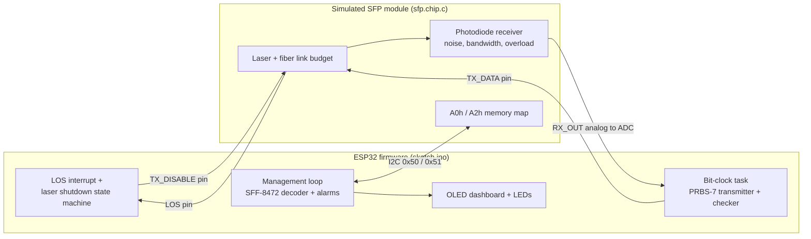

# OptiMon: SFP optical transceiver firmware with link simulation and BER testing

[](https://github.com/Apoo3va/optimon/actions/workflows/ci.yml)

ESP32 firmware that manages a simulated SFP optical transceiver, the way line-card software manages pluggable optics: it reads SFF-8472 diagnostics over I2C, raises alarms, shuts the laser down on loss of signal, and measures the link's bit error rate with a PRBS-7 tester.

The transceiver itself is a **custom Wokwi chip I wrote in C**. It models the SFF-8472 memory map, a 1550 nm fiber link budget and an optical receiver with noise, limited bandwidth and overload. This lets the firmware be developed and tested before real hardware exists.

**▶ Run it in your browser:** [Wokwi simulation](https://wokwi.com/projects/479143789644729345). Click the green chip while it runs to change fiber length, cut the fiber, add bend loss and more.

## Architecture



## Features

| Area | What it does |
| --- | --- |
| Transceiver management | Reads the SFF-8472 A0h (identity) and A2h (diagnostics) pages over I2C, validates the CC_BASE and CC_DMI checksums, loads the module's own alarm and warning thresholds, and decodes temperature, Vcc, laser bias, Tx power and Rx power |
| Alarms | Four thresholds per parameter, severity levels, OLED dashboard, LED status (blinking for a warning, solid for an alarm) |
| Optical link model | Fiber loss 0.2 dB/km, connectors and splices, bend loss, EDFA gain, laser aging, fiber cut; LOS with 2 dB hysteresis |
| Automatic laser shutdown | The LOS pin fires a hardware interrupt that turns the laser off inside the ISR; a state machine sends restart probes (5 s off, 2 s on) until light returns |
| Bit error rate tester | 1 kbit/s PRBS-7 on a timer task, mid-bit ADC sampling, adaptive decision threshold, self-synchronizing checker, measured BER plus a Q-factor BER estimate |
| Testing | 13 PC unit tests (198 checks) for the decoder and PRBS logic, built in CI with warnings as errors and AddressSanitizer / UndefinedBehaviorSanitizer |

## Results

All measurements come from the simulation. The defaults are -1 dBm launch power, 40 km of fiber, 10 dB extinction ratio and 7 mV rms receiver noise.

**Link budget:** measured Rx power matched the formula `Rx = Tx - 0.2 x km - 1.2 dB - bend + gain` to within 0.1 dB.

| Fiber length | Predicted Rx | Measured Rx | Status |
| --- | --- | --- | --- |
| 0 km | -2.2 dBm | -2.15 to -2.29 dBm | OK |
| 40 km | -10.2 dBm | -10.11 to -10.27 dBm | OK |
| 100 km | -22.2 dBm | -22.15 to -22.29 dBm | Low warning |

**Receiver sensitivity: about -27 dBm at BER 1e-4.** Counted BER and the BER estimated from the Q-factor agree.

| Rx power | Q | Errors / 5000 bits | Measured BER | BER from Q |
| --- | --- | --- | --- | --- |
| -24.2 dBm | 7.02 | 0 | < 2e-4 | 1.1e-12 |
| -26.2 dBm | 4.42 | 0 | < 2e-4 | 4.9e-6 |
| -27.2 dBm | 3.10 | 2 | 4.0e-4 | 9.5e-4 |
| -28.2 dBm | 2.78 | 14 | 2.8e-3 | 2.7e-3 |

**Impairments**, starting from -26.2 dBm (Q 4.46, no errors):

| Change | Q | Measured BER | Cause |
| --- | --- | --- | --- |
| Extinction ratio 10 to 4 dB | 2.35 | 9.2e-3 | Smaller gap between the 1 and 0 light levels |
| + receiver time constant 400 us | 1.51 | 6.7e-2 | Intersymbol interference: bits smear into their neighbours |
| 0 km fiber + 10 dB amplifier | 0.02 | 4.9e-1 | Receiver overload at +7.8 dBm: 1 and 0 become identical |

**Automatic laser shutdown:** the laser turned off within about 1 us of the LOS edge, and the link was restored 1 ms after the first successful probe once the fiber was repaired.

## A bug worth mentioning

The first ALS version sometimes logged a restart probe *before* the fiber-cut event, numbered "probe #0". The LOS interrupt was firing between two lines of the main loop that read shared state. I fixed it by taking a snapshot of the ISR-shared variables inside an ESP32 `portMUX` critical section, and then acting only on that snapshot.

## Repository layout

| File | Purpose |
| --- | --- |
| `sketch.ino` | ESP32 firmware: management loop, ALS state machine, BER tester |
| `sff8472.h` | SFF-8472 decoder (pure C++, unit-tested) |
| `prbs7.h` | PRBS-7 generator (pure C++, unit-tested) |
| `sfp.chip.c`, `sfp.chip.json` | Custom Wokwi chip: transceiver, fiber and receiver model |
| `diagram.json`, `libraries.txt` | Wokwi wiring and libraries |
| `tests/test_main.cpp` | PC unit tests |
| `.github/workflows/ci.yml` | CI: build with sanitizers and run the tests |

Run the tests locally:

```
g++ -std=c++17 -Wall -Wextra -Werror -fsanitize=address,undefined -I . tests/test_main.cpp -o run_tests && ./run_tests
```

## Limitations

- **Everything runs in simulation.** The firmware uses standard ESP32 Arduino APIs and should port to a real board and SFP cage, but it has not been run on hardware.
- **The transmitter and receiver share one clock**, so no clock and data recovery is needed. A real receiver recovers the clock from the data.
- **1 kbit/s is a simulator limit.** Real links run at gigabits per second, so BER below about 1e-4 is estimated from the Q-factor, as labs also do.
- **The receiver model is simplified:** Gaussian noise and a single-pole bandwidth limit, with no dispersion or nonlinear fiber effects.

## Author

Apoorva
