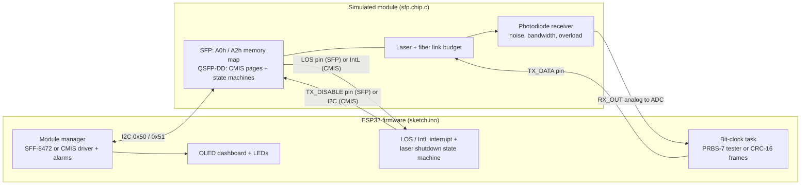
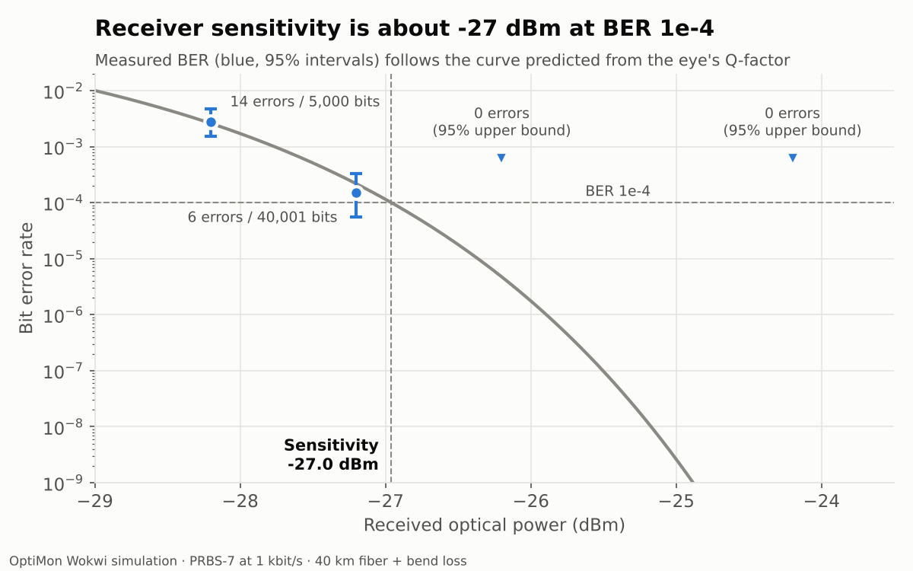
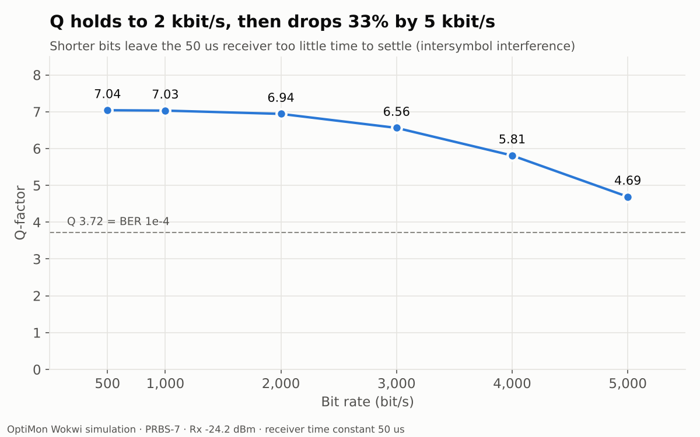

# OptiMon: optical module firmware (SFP and QSFP-DD CMIS) with link simulation and BER testing

[](https://github.com/Apoo3va/optimon/actions/workflows/ci.yml)

ESP32 firmware that manages simulated pluggable optics the way line-card software does. It identifies the module, brings it up, reads its diagnostics over I2C, raises alarms, shuts the laser down on loss of signal, measures the link's bit error rate with a PRBS-7 tester, and carries framed data protected by CRC-16.

It supports two module types and detects which one is plugged in: an **SFP managed through SFF-8472**, and a **QSFP-DD managed through CMIS 5.x**, the interface used by current high-speed and coherent pluggables such as 400ZR and 800ZR.

The module itself is a **custom Wokwi chip I wrote in C**. It models both management interfaces (the SFF-8472 memory map, and CMIS paged memory with its module and data path state machines), a 1550 nm fiber link budget, and an optical receiver with noise, limited bandwidth and overload. This lets the firmware be developed and tested before real hardware exists.

**▶ Run it in your browser:** [Wokwi simulation](https://wokwi.com/projects/479143789644729345). Click the green chip while it runs to swap the module type, change fiber length, cut the fiber, add bend loss and more.

## Architecture



## Features

| Area | What it does |
| --- | --- |
| Module detection | Reads the SFF-8024 identifier at 0x50 byte 0 and loads the SFF-8472 or CMIS driver; re-checks every second, so swapping the module type at runtime is detected and handled |
| SFP management (SFF-8472) | Reads the A0h (identity) and A2h (diagnostics) pages, validates the CC_BASE and CC_DMI checksums, loads the module's own thresholds, and decodes temperature, Vcc, laser bias, Tx power and Rx power |
| QSFP-DD management (CMIS 5.x) | Paged reads via bank/page select (bytes 126/127); identity and checksum from page 00h; thresholds from page 02h; host bring-up: clear LowPwrRequestSW, wait for ModuleReady, release DPDeinit on page 10h, wait for DPActivated on page 11h; lane monitors and latched flags from page 11h |
| Alarms | Four thresholds per parameter, severity levels, OLED dashboard, LED status (blinking for a warning, solid for an alarm) |
| Optical link model | Fiber loss 0.2 dB/km, connectors and splices, bend loss, EDFA gain, laser aging, fiber cut; LOS with 2 dB hysteresis |
| Automatic laser shutdown | SFP: the LOS pin fires an interrupt that turns the laser off inside the ISR. CMIS: IntL fires an interrupt, the firmware reads the latched flags over I2C, finds Rx LOS and disables the lane output on page 10h. Both then send restart probes (5 s off, 2 s on) until light returns |
| Bit error rate tester | PRBS-7 on a timer task, mid-bit ADC sampling, adaptive decision threshold, self-synchronizing checker, measured BER with a 95% confidence bound plus a Q-factor BER estimate |
| Framed data link | Preamble, sync word, sequence number, length, payload and CRC-16/CCITT; the receiver hunts for sync, checks the CRC and counts good, corrupted and missed frames (frame error rate) |
| Runtime control | Serial commands `prbs`, `frames` and `rate <bit/s>` (100 to 5000) switch modes and bit rate without rebuilding |
| Testing | 25 firmware logic tests (241 checks) for the SFF-8472 and CMIS decoders, PRBS, framing and CRC, plus 8 tests (40 checks) of the simulated module itself, compiled against a stand-in for the Wokwi API. All built in CI with warnings as errors and AddressSanitizer / UndefinedBehaviorSanitizer |

## Results

All measurements come from the simulation. The defaults are -1 dBm launch power, 40 km of fiber, 10 dB extinction ratio and 7 mV rms receiver noise.

**Link budget:** measured Rx power matched the formula `Rx = Tx - 0.2 x km - 1.2 dB - bend + gain` to within 0.1 dB.

| Fiber length | Predicted Rx | Measured Rx | Status |
| --- | --- | --- | --- |
| 0 km | -2.2 dBm | -2.15 to -2.29 dBm | OK |
| 40 km | -10.2 dBm | -10.11 to -10.27 dBm | OK |
| 100 km | -22.2 dBm | -22.15 to -22.29 dBm | Low warning |

**Receiver sensitivity: about -27 dBm at BER 1e-4.** Counted BER and the BER estimated from the Q-factor agree.



| Rx power | Q | Errors / bits | Measured BER | BER from Q |
| --- | --- | --- | --- | --- |
| -24.2 dBm | 7.02 | 0 / 5,000 | < 6e-4 (95%) | 1.1e-12 |
| -26.2 dBm | 4.42 | 0 / 5,000 | < 6e-4 (95%) | 4.9e-6 |
| -27.2 dBm | 3.55 | 6 / 40,001 | 1.5e-4 | 1.9e-4 |
| -28.2 dBm | 2.78 | 14 / 5,000 | 2.8e-3 | 2.7e-3 |

**Three methods agree at -27.2 dBm:** PRBS counted errors (BER 1.5e-4), the Q-factor estimate (1.4 to 2.3e-4), and framed data (8 CRC errors in 325 frames, FER 2.5%, implied BER 1.5e-4). At -10.2 dBm, 1,350 consecutive frames arrived with no errors and no gaps, which bounds BER below 1.3e-5 at 95% confidence.

**BER vs bit rate:** with a fixed 50 us receiver time constant, Q holds up to 2 kbit/s, then falls as each bit gets too short for the receiver to settle.



At 5 kbit/s the counted BER (2 errors in 75,000 bits, 2.7e-5) is higher than the Q estimate (1.3e-6). With intersymbol interference the received levels depend on the bit pattern rather than following one Gaussian spread, so a single Q value is optimistic. Two errors is a small sample, so this is a hint rather than a measurement.

**Impairments**, starting from -26.2 dBm (Q 4.46, no errors):

| Change | Q | Measured BER | Cause |
| --- | --- | --- | --- |
| Extinction ratio 10 to 4 dB | 2.35 | 9.2e-3 | Smaller gap between the 1 and 0 light levels |
| + receiver time constant 400 us | 1.51 | 6.7e-2 | Intersymbol interference: bits smear into their neighbours |
| 0 km fiber + 10 dB amplifier | 0.02 | 4.9e-1 | Receiver overload at +7.8 dBm: 1 and 0 become identical |

**Automatic laser shutdown:** with the SFP, the laser turned off within about 1 us of the LOS edge, inside the ISR. With CMIS there is no laser-disable pin, so shutdown needs an I2C read of the flags and an I2C write to page 10h after the IntL interrupt, which is slower. Either way the link was restored on the first probe after the fiber was repaired.

**CMIS bring-up**, from the firmware log after a hot-swap to the QSFP-DD module:

```
CMIS +0.00s: host clears LowPwrRequestSW (byte 26 bit 4)
CMIS +0.05s: ModuleLowPwr -> ModulePwrUp
CMIS +2.05s: ModulePwrUp -> ModuleReady
CMIS +2.10s: host clears DPDeinit lane 1 (page 10h byte 128)
CMIS +2.15s: lane 1 DPDeactivated -> DPInit
CMIS +3.15s: lane 1 DPInit -> DPActivated
CMIS +3.15s: link UP, lane 1 carrying traffic
```

## Bugs worth mentioning

- **ISR race condition.** The first ALS version sometimes logged a restart probe *before* the fiber-cut event, numbered "probe #0". The LOS interrupt was firing between two lines of the main loop that read shared state. I fixed it by taking a snapshot of the ISR-shared variables inside an ESP32 `portMUX` critical section, and then acting only on that snapshot.
- **Frames counted twice.** Every CRC error was followed by exactly one "missed" frame, because the next good frame's sequence number showed a gap. The frame error rate disagreed with the PRBS BER by a factor of two, which exposed it. The receiver now subtracts frames already counted as bad, and a unit test covers it.
- **False LOS on hot-swap.** Swapping an SFP for a QSFP-DD moves the shared pin (LOS is active high, IntL active low), and the SFP driver logged a fiber cut that never happened. The firmware now confirms the module identifier before acting on a LOS edge.
- **Timestamp wrap-around, found only with real I2C timing.** In Wokwi every CMIS restart probe declared "light is back" after 50 ms although the fiber was still cut. The loop captured `now = millis()` and then serviced the flags over I2C, which takes milliseconds, so the "LOS last seen" time was newer than `now` and `now - lastSeen` wrapped to a huge unsigned value. My PC test harness treated I2C as instantaneous and missed it; it now charges 400 kHz bus time, reproduces the bug, and confirms the fix (re-read the clock after I2C, compare with signed differences).
- **Arduino prototype order.** The Arduino builder inserts function prototypes above the first function, so a struct used in a function signature must be defined before it.

## Repository layout

| File | Purpose |
| --- | --- |
| `sketch.ino` | ESP32 firmware: management loop, ALS state machine, BER tester |
| `sff8472.h` | SFF-8472 decoder (pure C++, unit-tested) |
| `cmis.h` | CMIS register map, module and data path state decoding, page 02h thresholds (pure C++, unit-tested) |
| `prbs7.h` | PRBS-7 generator (pure C++, unit-tested) |
| `frame.h` | Frame builder, CRC-16 and bit-serial frame receiver (pure C++, unit-tested) |
| `sfp.chip.c`, `sfp.chip.json` | Custom Wokwi chip: SFP or QSFP-DD module, fiber and receiver model |
| `diagram.json`, `libraries.txt` | Wokwi wiring and libraries |
| `tests/test_main.cpp` | Firmware logic tests |
| `tests/test_chip.cpp`, `tests/wokwi_stub.*`, `tests/wokwi-api.h` | Tests of the simulated module, with a PC stand-in for the Wokwi chip API |
| `.github/workflows/ci.yml` | CI: build with sanitizers and run the tests |
| `ber_vs_power.png`, `q_vs_bitrate.png` | Result charts |

Run the tests locally:

```
g++ -std=c++17 -Wall -Wextra -Werror -fsanitize=address,undefined -I . tests/test_main.cpp -o run_tests && ./run_tests
gcc -std=c11 -I tests -c sfp.chip.c tests/wokwi_stub.c && g++ -std=c++17 -I tests -I . tests/test_chip.cpp sfp.chip.o wokwi_stub.o -o run_chip_tests && ./run_chip_tests
```

## Limitations

- **Everything runs in simulation.** The firmware uses standard ESP32 Arduino APIs and should port to a real board and SFP cage, but it has not been run on hardware.
- **The transmitter and receiver share one clock**, so no clock and data recovery is needed. A real receiver recovers the clock from the data.
- **Up to 5 kbit/s is a simulator limit.** Real links run at gigabits per second, so BER below about 1e-4 is estimated from the Q-factor, as labs also do.
- **The CMIS model is a subset.** It implements bank 0 with pages 00h, 02h, 10h and 11h, the module and data path state machines, and latched flags with IntL. It leaves out application selection and the staged control set, flag masks, CDB commands, and the C-CMIS / VDM pages where coherent modules report pre-FEC BER, OSNR and chromatic dispersion. To make the bring-up visible, the module powers up with LowPwrRequestSW set, so the host must release it.
- **The link is direct detection, not coherent.** Light on means 1. Coherent modules carry data in phase and polarization and recover it with a DSP.
- **The receiver model is simplified:** Gaussian noise and a single-pole bandwidth limit, with no dispersion or nonlinear fiber effects.

## Author

Apoorva
